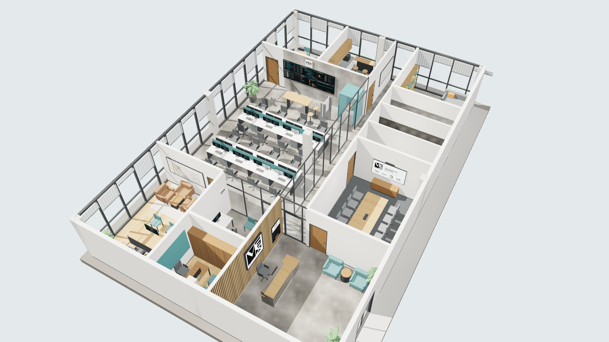

# Sede Grupo VEX — estudo preliminar

**Um ecossistema, um padrão.**

Proposta de arquitetura corporativa para a sede física do Grupo VEX, que reúne
Sistema VEX, EAP Goiânia, Vexor Engenharia e VEX View. Cliente: Thiago Siqueira, CEO.
Revisão 00, outubro de 2026.

A planta baixa, a maquete e todas as perspectivas são geradas a partir de **um
único modelo** (`js/model.js`). Por isso a planta e as imagens mostram sempre o
mesmo escritório.



## Como abrir

| O quê | Onde |
| --- | --- |
| **Escritório de agentes 3D** (bonecos, contratar, ligar, conversar, reunir) | `agentes.html` · no seu computador: http://localhost:4321/sede · demonstração: https://sistemavex.github.io/Escritorio-de-agentes/sede-grupo-vex/agentes.html |
| **Escritório virtual 3D** (tela cheia, ambientes e tour) | `escritorio.html` · online: https://sistemavex.github.io/Escritorio-de-agentes/sede-grupo-vex/escritorio.html |
| Apresentação completa (10 entregáveis + modelo 3D navegável) | `index.html` (abrir no navegador, com internet para fontes e three.js) |
| Perspectivas prontas (1920 × 1080) | pasta `renders/` |
| Planta baixa humanizada | `planta-baixa.svg` |
| Planta com rota de fuga e zoneamento acústico | `planta-baixa-rotas-e-ruido.svg` |
| Modelo 3D para o escritório de arquitetura | `modelo/sede-grupo-vex.glb` (Blender, Enscape, D5 Render, Twinmotion, SketchUp com importador glTF) |
| Logos oficiais usadas, sem alteração | `assets/logos/` |
| Resumo do briefing | `BRIEFING.md` |

## Escritório de agentes 3D

Os agentes de IA do Escritório de Agentes trabalham dentro do modelo da sede:

- cada agente é um boneco sentado numa **mesa real** do projeto (bancadas de operações,
  CEO, planejamento, jurídico, financeiro, recepção);
- **Descansar** leva o agente para a copa ou a sala de jogos; **Reunião** leva para a sala de reunião;
- painel com **Equipe**, **Contratar** (vagas sugeridas para o Grupo VEX e cadastro de agente com
  sistema local ou site) e **Reunião** (os agentes consultam o próprio projeto pelo Claude Code e
  sai um briefing do dia);
- na ficha do agente: ligar e desligar o sistema, abrir o sistema dentro do escritório, ver o log,
  **conversar** com ele pelo Claude Code, trocar de mesa e editar nome, função e emoji.

Para usar de verdade, rode o escritório no seu computador, a partir da raiz do repositório:

```bash
npm start
```

e abra **http://localhost:4321/sede**. A equipe é a mesma do escritório isométrico
(`data/equipe.json`), então os dois mostram as mesmas pessoas. No escritório isométrico
há um botão **🏢 Sede 3D**.

O link público (GitHub Pages) abre em **modo demonstração**: dá para contratar e mover
agentes, mas ligar sistemas, conversar e reunir só funcionam com o servidor no seu computador.

## Entregáveis

| Nº | Entregável | Arquivo |
| --- | --- | --- |
| Etapa 1 | Análise das logos | `index.html#arquivos` |
| Etapa 2 | Premissas e dimensionamento | `index.html#premissas` |
| 1 | Conceito arquitetônico | `index.html#conceito` |
| 2 | Planta baixa humanizada | `planta-baixa.svg` |
| 3 | Vista geral | `renders/aerea.jpg`, `renders/aerea-ne.jpg`, `renders/galeria.jpg` |
| 4 | Recepção institucional | `renders/recepcao.jpg`, `renders/ecossistema.jpg` |
| 5 | Sala do CEO | `renders/ceo.jpg` |
| 6 | Operações e controle de obras | `renders/operacoes.jpg`, `renders/painel.jpg`, `renders/planejamento.jpg` |
| 7 | Sala de reunião | `renders/reuniao.jpg` |
| 8 | Ambientes complementares | `renders/financeiro.jpg`, `renders/juridico.jpg`, `renders/copa.jpg`, `renders/jogos.jpg`, `renders/wc.jpg` |
| 9 | Materiais e identidade visual | `index.html#materiais` |
| 10 | Apresentação consolidada e modelo 3D | `index.html`, `modelo/sede-grupo-vex.glb` |

## Premissas (a confirmar com o imóvel real)

- Laje em edifício comercial em Goiânia, 20,00 × 13,00 m = **260 m² internos**.
- Fachadas envidraçadas a norte e a leste, empena cega a oeste, núcleo do edifício ao sul.
- Pilares 40 × 40 cm em malha de 10,00 × 6,50 m; laje aparente; pé-direito livre de 3,10 m.
- 23 postos fixos: CEO 1, planejamento 1, jurídico 1, financeiro 3, operações 16, recepção 1.

**Dimensionamento:** o programa pedido não cabe em 180 m² sem cortes. Em 250 m²
cabe no limite (14 postos em operações). A área recomendada é de **260 a 280 m²**.

## Quadro de áreas

| Nº | Ambiente | Área (m²) | Capacidade |
| --- | --- | ---: | --- |
| 01 | Sala do CEO | 23,52 | 1 posto + 5 lugares |
| 02 | Jurídico | 8,96 | 1 posto + 2 lugares |
| 03 | Planejamento (eng. de planejamento) | 8,96 | 1 posto |
| 04 | Recepção | 31,36 | 1 posto + 2 espera |
| 05 | Operações e Controle de Obras | 75,48 | 16 postos + daily |
| 06 | Financeiro | 16,80 | 3 postos + mesa |
| 07 | Copa | 14,28 | 5 lugares |
| 08 | Galeria (circulação) | 21,60 | — |
| 09 | Reunião | 22,14 | 11 lugares |
| 10 | Apoio / TI | 5,74 | — |
| 11 | WC feminino (acessível) | 6,97 | — |
| 12 | WC masculino (acessível) | 6,97 | — |
| 13 | Jogos e descompressão | 17,22 | 6 pessoas |
| | **Total** | **260,00** | |

## Sobre as logos

As cinco logos foram usadas exatamente como recebidas (PNG 500 × 500, fundo
transparente), sem redesenho, recorte ou mudança de cor. Medindo os arquivos, todo
o "branco" das marcas é transparência; por isso, no projeto, toda logo fica sobre
placa branca ou caixa de luz branca. Nenhuma versão alternativa foi criada.

## O que falta receber

- Versões vetoriais (AI, PDF ou SVG) das cinco logos e, se existirem, as versões negativas.
- Manual de marca ou fontes e cores oficiais.
- Fotos reais das obras e imagens aéreas da VEX View (a galeria e o totem estão reservados para elas).
- Planta do imóvel escolhido.

## Limitações

- As perspectivas são renderizações em tempo real (WebGL) do modelo, com sol,
  sombras e materiais simulados. Não são imagens fotorrealistas de pós-produção.
  Para isso, use o `.glb` em Enscape, D5 Render ou Twinmotion.
- Os números nas telas do painel de operações são ilustrativos.
- É um estudo conceitual. Não substitui projeto executivo: precisa de levantamento
  do imóvel e de profissionais habilitados, com verificação de NBR 9050, NBR 9077 e
  instruções do CBMGO, NR-17, NR-24, NBR ISO/CIE 8995-1, NBR 10152 e NBR 5410.

## Para editar e regenerar

```bash
node tools/build-plan.js
```
Regera as plantas SVG a partir de `js/model.js`.

```bash
node tools/serve.js 4610
```
Abre um servidor local em `http://127.0.0.1:4610`. No console do navegador,
`await VEXExport()` regrava as imagens em `renders/` e `await VEXExport({ renders: false, glb: true })`
regrava o modelo `.glb`.

## Estrutura

```
index.html            apresentação
css/style.css         estilo da apresentação
js/model.js           modelo único: ambientes, paredes, portas, mobiliário, câmeras
js/plan.js            gerador da planta baixa (SVG)
js/scene3d.js         modelo 3D, materiais, iluminação e renderização
js/app.js             montagem da página
js/logos.js           logos oficiais embutidas (para abrir sem servidor)
assets/logos/         logos oficiais originais
renders/              perspectivas exportadas
modelo/               modelo 3D .glb
tools/                scripts para regenerar plantas, imagens e modelo
```
